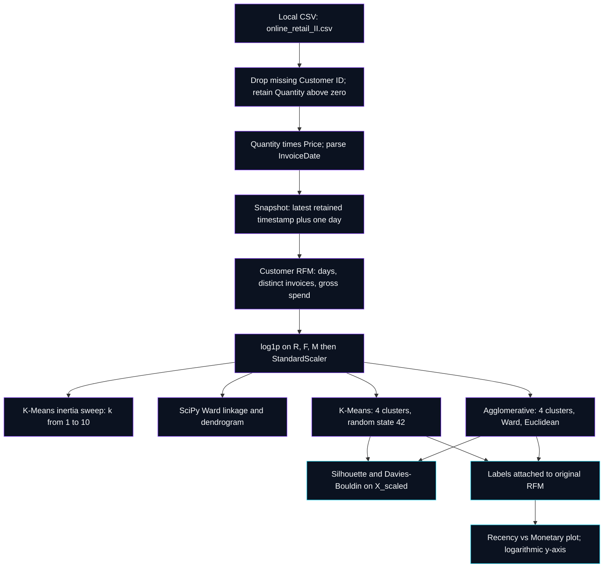

<p align="center">
  
</p>

<h1 align="center">Customer Segmentation Intelligence</h1>
<p align="center"><strong>Discovering Customer Behavior Through RFM Analytics and Unsupervised Learning</strong></p>

<p align="center">
  
  
  
  
  
</p>

**Three behavioral features. Two clustering methods. Four configured groups per method.**
A customer analytics case study with preserved notebook results, traceable methodology, and an explicit account of what the evidence can support.

## Contents

[01 Overview](#executive-overview) / [02 Business problem](#business-problem) / [03 Dataset](#dataset-and-provenance) / [04 RFM](#understanding-rfm-analysis) / [05 Cleaning](#data-cleaning) / [06 Features](#rfm-feature-engineering) / [07 Scaling](#data-transformations-and-scaling) / [08 Architecture](#machine-learning-architecture) / [09 K-Means](#k-means-clustering) / [10 Hierarchical](#hierarchical-clustering) / [11 Evaluation](#cluster-selection-and-evaluation) / [12 Segments](#customer-segment-profiles) / [13 Visuals](#visual-analysis) / [14 Limitations](#technical-decisions-and-limitations) / [15 Structure](#repository-structure) / [16 Reproduction](#installation-and-reproduction) / [17 Roadmap and credits](#future-roadmap-author-and-credits)

## Executive Overview

This project aggregates retail invoice lines into customer-level Recency, Frequency, and Monetary features. It applies `np.log1p` and `StandardScaler`, then compares K-Means with Ward agglomerative clustering in the same three-dimensional feature space.

| Saved notebook result | K-Means | Hierarchical |
|---|---:|---:|
| Configured clusters | 4 | 4 |
| Silhouette score, higher is better | **0.3663** | 0.3314 |
| Davies-Bouldin index, lower is better | 0.9355 | **0.9317** |

Metrics come from notebook **cell 16**, not a new run. They describe one saved in-sample comparison. The input CSV and original package versions are absent. [Evidence and original-file hashes](docs/EVIDENCE.md) make that boundary reviewable.

## Business Problem

Customers differ in purchase timing, repeat activity, and spending. RFM offers an interpretable basis for exploring those differences before designing retention, onboarding, or loyalty experiments. The implementation compares partitions; it does not measure campaign response, profit uplift, churn probability, or customer lifetime value.

## Dataset and Provenance

The project references Online Retail II and reads `online_retail_II.csv` from the working directory. The CSV is not included, so its exact row count, coverage, and conversion history cannot be verified locally. The original README linked the [Kaggle mirror](https://www.kaggle.com/datasets/mashlyn/online-retail-ii-uci).

The [upstream UCI record](https://archive.ics.uci.edu/dataset/502/online+retail+ii) lists **1,067,371 invoice-line records**, rather than unique receipts. That is source scale, not a verified count for the missing local CSV. Prices are described in GBP. See the [dataset provenance and exact CSV contract](docs/DATASET.md) for preparation requirements and attribution.

## Understanding RFM Analysis

| Feature | Implemented meaning | Direction for interpretation |
|---|---|---|
| Recency | Whole days from latest purchase to snapshot | Lower means more recent |
| Frequency | Distinct invoices per customer | Higher means more invoice activity |
| Monetary | Sum of `Quantity * Price` | Higher means more retained gross spend |

RFM describes observed behavior within the input window. It does not establish customer intent or future value.

This implementation uses continuous RFM features, rather than quartile scores or concatenated RFM codes. Frequency counts unique invoice IDs, so several product lines on one invoice count once. Monetary still sums every retained line. The [RFM methodology reference](docs/RFM_METHOD.md) defines the formulas, pandas defaults, and interpretation boundaries.

## Data Cleaning

The original code drops missing `Customer ID` rows and retains `Quantity > 0`. It computes `TotalPrice` and parses `InvoiceDate`. There is no explicit invoice-prefix cancellation check, duplicate removal, or positive-price filter.

| Step in the original pipeline | Effect | What it does not establish |
|---|---|---|
| `dropna(subset=['Customer ID'])` | Restricts aggregation to identifiable customers | Missingness is not quantified or shown to be unbiased |
| `query('Quantity > 0')` | Excludes nonpositive quantities | Cancellation prefixes are not inspected; earlier purchases are not reconciled with returns |
| `Quantity * Price` | Creates each retained line's value | Zero, negative, or missing prices are not checked |
| `pd.to_datetime(InvoiceDate)` | Converts timestamps before aggregation | No explicit date format, timezone, or invalid-date policy is recorded |

Positive quantity alone is an incomplete definition of a completed purchase. The code's filter may remove ordinary negative-quantity cancellation rows, but the absent CSV prevents checking whether every cancellation is covered. Likewise, duplicates are neither counted nor removed: their effect on spend is unknown. No row-retention counts or cleaning diagnostics are saved. See [the exact operations](customer_segmentation_rfm_clustering.py#L15).

## RFM Feature Engineering

The snapshot is the maximum retained invoice timestamp plus one day. Grouping by `Customer ID` produces one RFM row per customer, using the latest timestamp, unique invoice count, and summed line values. Only the first five RFM rows are saved; a full profile export is absent.

The [saved preview in notebook cell 6](customer_segmentation_rfm_clustering.ipynb) contains these actual rows:

| Customer ID | Recency, days | Frequency, distinct invoices | Monetary, source currency |
|---|---:|---:|---:|
| 12346.0 | 326 | 12 | 77,556.46 |
| 12347.0 | 2 | 8 | 5,633.32 |
| 12348.0 | 75 | 5 | 2,019.40 |
| 12349.0 | 19 | 4 | 4,428.69 |
| 12350.0 | 310 | 1 | 334.40 |

These are the first five customer-indexed rows, **not cluster means or representative samples**. Recency uses elapsed whole days from a shared timestamp, with fractional days discarded. The exact snapshot timestamp is not saved. The operation is described precisely in [RFM methodology](docs/RFM_METHOD.md#definitions).

After fitting, two label columns are attached to this raw-unit table. They do not enter the clustering matrix: `X_scaled` was already created from the three original features. No customer tenure or first-purchase date is calculated, so a recent low-frequency customer cannot automatically be called a new buyer.

## Data Transformations and Scaling

`np.log1p(rfm)` transforms **all three features**, followed by a single `StandardScaler.fit_transform`. Both algorithms consume the same `X_scaled` matrix. Log compression and standardization do not establish robustness to extreme customers.

For each feature value `x`, the pipeline first computes `u = log(1 + x)` and then `z = (u - mean(u)) / std(u)` using the retained customer population. This compresses large raw differences and makes each transformed feature contribute on a comparable variance scale. Recency is transformed too; the code does not invert its direction or give any feature a manual weight.

| Design choice | Benefit | Remaining boundary |
|---|---|---|
| Log all RFM columns | Compresses large magnitudes before distance calculations | No saved before/after skewness assessment |
| Fit one scaler before both models | Keeps model comparison in the same feature geometry | It is fit on the same snapshot used for evaluation |
| Preserve `rfm`; build `X_scaled` separately | Supports raw-unit plotting after fitting | Full raw-unit cluster summaries are not saved |

Real-valued `log1p` requires values greater than -1; an aggregate at -1 produces negative infinity and values below -1 are invalid. The original pipeline has no finite-value check before fitting. Zero spend transforms to zero, but is not thereby a validated purchase. [StandardScaler is sensitive to outliers](https://scikit-learn.org/stable/modules/generated/sklearn.preprocessing.StandardScaler.html), so log compression should be evaluated rather than described as eliminating their influence. See [script lines 28-31](customer_segmentation_rfm_clustering.py#L28).

## Machine Learning Architecture



The elbow and dendrogram are diagnostics. Neither programmatically selects the hard-coded four-cluster setting.

## K-Means Clustering

K-Means uses `n_clusters=4`, `init='k-means++'`, and `random_state=42`. An earlier sweep evaluates inertia for k=1 through 10. `n_init` is left at the installed library default; the original environment was not recorded.

| Parameter / output | Recorded behavior |
|---|---|
| Input | The three standardized log-RFM columns in `X_scaled` |
| Elbow diagnostic | Fit a separate estimator at each k=1...10; collect `inertia_` |
| Final fit | Four centers; k-means++ initialization; seed 42 |
| Labels | `fit_predict(X_scaled)` assigned to `rfm['Cluster_KMeans']` |
| Evaluation | Same fitted population and matrix; no holdout |

The objective minimizes within-cluster squared Euclidean distances in the transformed space. Raw-spend differences have already been compressed, so centers must be interpreted with the transformation in mind. The implementation does not export centers, labels, or a fitted model.

A fixed seed controls initialization within a given environment; it does not demonstrate stability across seeds or package versions. In particular, [scikit-learn changed the default `n_init` in version 1.4](https://scikit-learn.org/1.5/modules/generated/sklearn.cluster.KMeans.html). That omission can change the number of starts and the resulting partition. Source: [elbow loop](customer_segmentation_rfm_clustering.py#L44) and [final fit](customer_segmentation_rfm_clustering.py#L60).

## Hierarchical Clustering

SciPy builds the Ward dendrogram from `X_scaled`. A separate scikit-learn `AgglomerativeClustering(n_clusters=4, metric='euclidean', linkage='ward')` fit generates hierarchical labels. The notebook does not cut the SciPy tree to obtain those labels.

Ward linkage merges groups to limit the increase in within-cluster variance. The dendrogram and agglomerative fit use the same transformed customer matrix and a consistent Ward/Euclidean setup. This is a meaningful comparison with K-Means, but the two methods share a preference for compact groups; their diagnostics are not independent confirmation of a unique natural segmentation.

| Component | Implementation | Interpretation |
|---|---|---|
| Tree diagnostic | `sch.linkage(X_scaled, method='ward')` | Full merge hierarchy of customer vectors |
| Display | `sch.dendrogram(...)` | Merge heights; no explicit four-group cut line |
| Final labels | Separate four-cluster agglomerative fit | Stored in `Cluster_Hierarchical` |

The [SciPy linkage documentation](https://docs.scipy.org/doc/scipy/reference/generated/scipy.cluster.hierarchy.linkage.html) describes quadratic memory use for linkage. The relevant population is aggregated customers, not raw invoice lines; its exact size is not saved. The full dendrogram also has dense, unreadable leaf labels at the existing image size. The `metric` keyword requires [scikit-learn 1.2 or later](https://scikit-learn.org/stable/modules/generated/sklearn.cluster.AgglomerativeClustering.html); this is an API requirement, not evidence of the historical version. Source: [tree](customer_segmentation_rfm_clustering.py#L35) and [label fit](customer_segmentation_rfm_clustering.py#L63).

## Cluster Selection and Evaluation

The saved metrics favor K-Means on silhouette and hierarchical clustering on Davies-Bouldin. Neither algorithm dominates both measures. Four clusters are a configured exploratory choice; there is no saved silhouette sweep across K or stability experiment.

## Customer Segment Profiles

The plots show IDs 0-3 for each algorithm, but the repository saves no cluster counts, centroids, or full RFM summaries. Persona names and numeric marketing thresholds therefore remain hypotheses. Cluster IDs are arbitrary and do not identify matching groups across algorithms.

## Visual Analysis

The repository preserves three original charts: [elbow](images/elbow_method.png), [dendrogram](images/dendrogram.png), and [cluster comparison](images/cluster_comparison.png). They visualize model diagnostics and a two-feature projection of the fitted partitions.

## Technical Decisions and Limitations

Invoice-based Frequency and a shared transformed matrix align with the stated RFM comparison. Important limits remain: missing input provenance, incomplete validation of cancellations and prices, no duplicate policy, unknown package versions, and no stability or campaign evidence. The model fits and evaluates the same customer snapshot.

## Repository Structure

```text
Customer-Segmentation-RFM/
|-- customer_segmentation_rfm_clustering.ipynb
|-- customer_segmentation_rfm_clustering.py
|-- images/
|   |-- customer-intelligence-banner.svg
|   |-- cluster_comparison.png
|   |-- dendrogram.png
|   `-- elbow_method.png
|-- docs/
|   |-- DATASET.md
|   |-- EVIDENCE.md
|   `-- RFM_METHOD.md
|-- LICENSE
`-- README.md
```

Notebook and script are at the repository root. A dataset and dependency manifest are not tracked.

## Installation and Reproduction

Open the root notebook to inspect its saved results without executing it. A fresh run requires an independently supplied `online_retail_II.csv` and a compatible Python environment. The script writes the original image paths; use a separate disposable copy for experiments.

## Future Roadmap, Author and Credits

Future work should first recover the original input hash and environment, quantify cleaning decisions, and save cluster counts and RFM summaries. Then compare K and random seeds, assess temporal stability, and test any proposed marketing treatment with measured outcomes. These are proposed experiments, not implemented features.

**Khaled Amireh** / [GitHub](https://github.com/khaled-amireh) / [Portfolio](https://portfolio-1kpn.onrender.com)

Built with Python, pandas, NumPy, scikit-learn, SciPy, Matplotlib, and Seaborn. Repository code is under the [MIT license](LICENSE); dataset licensing and attribution must be considered separately.
