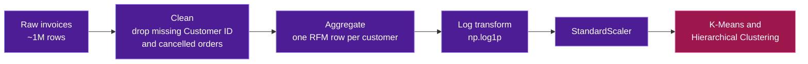
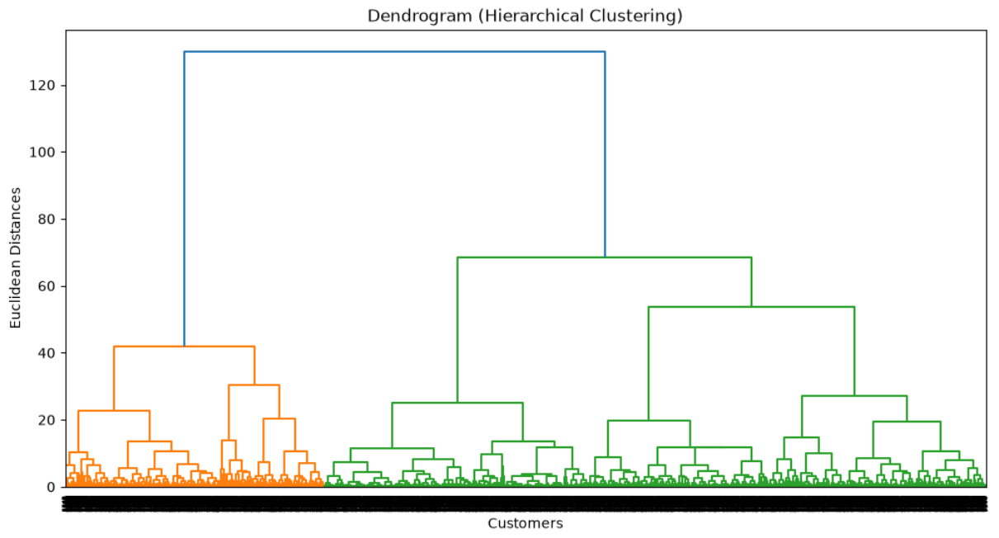
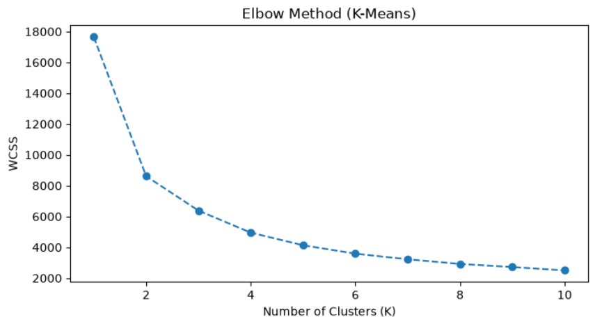
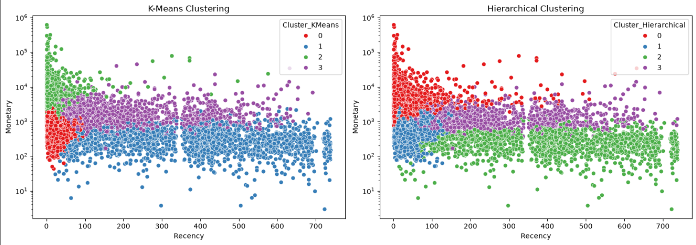
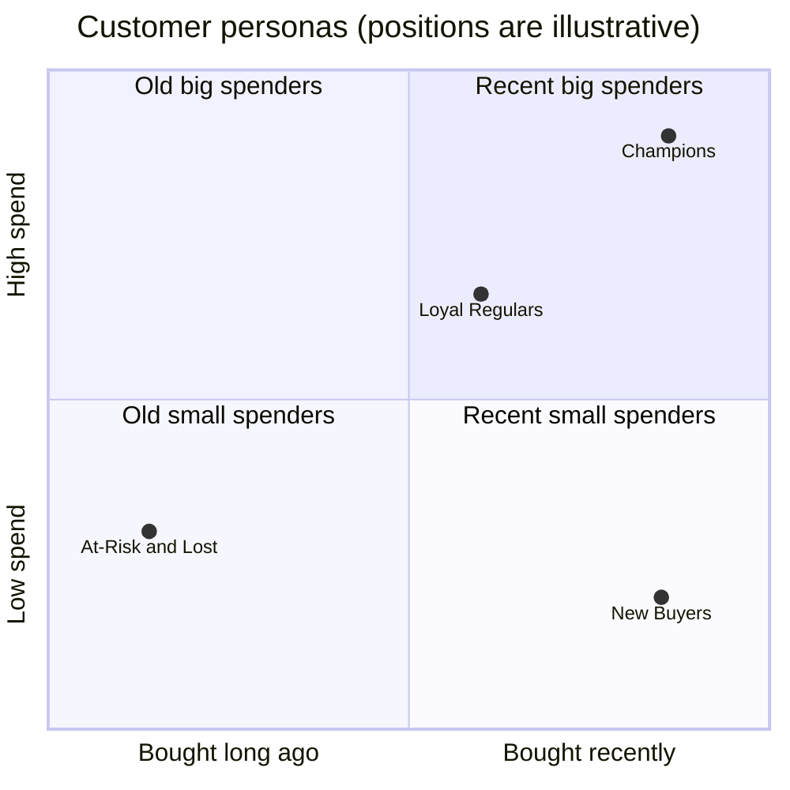

<p align="center">
  
</p>

<p align="center">
  
</p>

<p align="center">
  
  
  
</p>

<p align="center">
  
  
  
  
  
</p>

<p align="center">
  <a href="#-the-big-idea">Big Idea</a> •
  <a href="#-rfm-in-10-seconds">RFM</a> •
  <a href="#-dataset">Dataset</a> •
  <a href="#-from-receipts-to-people-feature-engineering">Engineering</a> •
  <a href="#-how-many-groups-k--4">Choosing K</a> •
  <a href="#-the-duel-k-means-vs-hierarchical">The Duel</a> •
  <a href="#-meet-the-4-personas">Personas</a>
</p>

---

##  The Big Idea

> [!NOTE]
> **In one sentence:** this project reads about a million store receipts, turns them into one simple profile per customer, and lets two clustering algorithms sort everyone into **4 groups**, each with its own marketing plan.

**Explain it like I'm five:**
Imagine a shop owner holding a giant pile of receipts. Sending the same discount email to *everyone* is wasteful: your best customer, a first-time visitor, and someone who left two years ago need very different messages. So we sort customers into groups of "people who behave alike" **without telling the computer what the groups are**. That is called *unsupervised learning*.

```
 ~1M receipts  ➜   One profile per customer (RFM)  ➜   Clustering  ➜  4 personas + a plan for each
```

---

##  RFM in 10 Seconds

Three questions describe almost any shopper:

| | Letter | The question | Measured as |
|:-:|:-:|---|---|
|  | **R**ecency | *How recently did they shop?* | Days since last completed purchase |
|  | **F**requency | *How often do they shop?* | Number of distinct completed purchases |
|  | **M**onetary | *How much do they spend?* | Total revenue from that customer |

> RFM was chosen because three business-friendly numbers are easy to explain to a marketing team, and that matters as much as the math.

---

##  Dataset

**Source:** [Online Retail II Dataset on Kaggle](https://www.kaggle.com/datasets/mashlyn/online-retail-ii-uci)

**Scale:** ~1,000,000 raw invoice transactions, collapsed into one RFM profile per unique customer.

---

##  From Receipts to People (Feature Engineering)



**Before and after** (an illustrative example, not real rows from the dataset):

| Before: many receipt lines | | After: one customer profile | |
|---|---|---|---|
| Customer 17850, 3 Dec, £20 | | **Recency** | 12 days |
| Customer 17850, 9 Dec, £35 | ➜ | **Frequency** | 3 purchases |
| Customer 17850, 15 Dec, £45 | | **Monetary** | £100 |

<details>
<summary><b> Step 1: Cleaning (click to expand)</b></summary>

<br/>

Dropped rows missing `Customer ID` and removed cancelled or negative-quantity rows (`Quantity > 0`), so RFM reflects only real, completed purchases.

</details>

<details>
<summary><b> Step 2: Aggregation (click to expand)</b></summary>

<br/>

Computed spend per line (`Quantity × Price`), then grouped by `Customer ID` to calculate Recency, Frequency, and Monetary. About 1M rows became one row per customer.

</details>

<details>
<summary><b>📉 Step 3: Log transform, the "billionaire in the room" fix (click to expand)</b></summary>

<br/>

Monetary and Frequency were heavily right-skewed. Picture ten people in a room and one billionaire walks in: the *average* wealth explodes, and it tells you nothing about the typical person. A few mega-spenders would do the same to the clustering distances, so `np.log1p()` was applied to shrink the extremes and let the typical behavior show.

</details>

<details>
<summary><b>📏 Step 4: Scaling (click to expand)</b></summary>

<br/>

`StandardScaler` puts Recency, Frequency, and Monetary on the same scale. Both algorithms are distance-based, so without this, a feature measured in big numbers (money) would quietly bully a feature measured in small ones (order counts).

</details>

---

## 🎯 How Many Groups? (K = 4)

Instead of guessing, two **independent** methods were used to cross-check the number of clusters.

### 🌳 Method 1: The Dendrogram (a family tree of customers)

With `ward` linkage and Euclidean distance, customers are merged step by step into one big tree. Cutting where the vertical gaps are largest reveals **4 natural groupings**.

<p align="center">
  
</p>

### 💪 Method 2: The Elbow (bend your arm)

The WCSS plot (how tightly packed the clusters are) drops fast, then flattens. The bend, the "elbow", sits at **K = 4**: past that point, extra clusters barely help.

<p align="center">
  
</p>

> [!IMPORTANT]
> **Two different methods, one answer.** The dendrogram (linkage distances) and the elbow (variance minimization) reach K = 4 by completely different math. Agreement between them is what makes the choice trustworthy.

---

## ⚔️ The Duel: K-Means vs Hierarchical

Both algorithms ran on the same scaled RFM data. There are no "correct answer" labels in unsupervised learning, so they are judged with two *internal* scores.

| | Silhouette ↑ | Davies-Bouldin ↓ |
|---|:---:|:---:|
| 🥇 **K-Means** | **0.3663** 🏅 | 0.9355 |
| 🥈 **Hierarchical** | 0.3314 | **0.9317** 🏅 |

**Reading the scores in plain words:**

- **Silhouette** (higher is better) asks *"does each customer feel at home in their own group, far from the others?"* K-Means scores a bit higher, so its groups are slightly tighter and more distinct.
- **Davies-Bouldin** (lower is better) asks *"how much does each group overlap with its closest neighbor?"* Hierarchical edges it by a hair.

Each algorithm wins one round, which is common when comparing these two families. **K-Means was used for the final personas** because of its stronger Silhouette Score and its much better scalability to large customer bases.

### 🔍 Side-by-Side View

How each algorithm splits customers on the Recency vs Monetary plane:

<p align="center">
  
</p>

---

## 🎭 Meet the 4 Personas

<table>
  <tr>
    <td align="center" width="25%">🏆<br/><b>Champions / VIP</b><br/><sub>Recent, frequent, big spenders</sub><br/><br/>🎁 VIP rewards, early access, dedicated support</td>
    <td align="center" width="25%">💛<br/><b>Loyal Regulars</b><br/><sub>Steady, frequent, good spenders</sub><br/><br/>🛒 Cross-sell and a loyalty points program</td>
    <td align="center" width="25%">🌱<br/><b>Recent / New Buyers</b><br/><sub>Just arrived, spending lightly</sub><br/><br/>👋 Welcome discount, onboarding emails, popular picks</td>
    <td align="center" width="25%">⏳<br/><b>At-Risk / Lost</b><br/><sub>Gone quiet for a long time</sub><br/><br/>💌 Win-back campaigns and re-engagement offers</td>
  </tr>
</table>

### 📋 The Playbook

| Segment | Avg. Recency | Avg. Frequency | Avg. Monetary | Strategy |
|---|:---:|:---:|:---:|---|
| 🏆 **Champions / VIP** | Low (< 30 days) | High (> 15 orders) | High (> $10,000) | Exclusive VIP rewards, early access to new collections, dedicated account support |
| 💛 **Loyal Regulars** | Moderate (30–90 days) | High (> 10 orders) | Moderate–High | Cross-selling recommendations, loyalty points to maximize Customer Lifetime Value (CLV) |
| 🌱 **Recent / New Buyers** | Low recency, low order count | Low | Low–Moderate | Welcome discount codes, onboarding email sequences, popular product suggestions |
| ⏳ **At-Risk / Lost** | High–Very High (> 120–250+ days) | Low (1–2 orders) | Low–Moderate | Targeted win-back campaigns, re-engagement promotions, low-cost automated emails |

### 🗺️ Where each persona lives



> [!TIP]
> **Why this matters:** every cluster is more than a statistical blob. It is a group a marketing team can act on, each with its own message and budget, instead of one blanket campaign for everyone.

---

## 🧰 Technologies Used

| Category | Tools |
|---|---|
| Language | 🐍 Python |
| Data Handling | Pandas, NumPy |
| Machine Learning | Scikit-learn (K-Means, Agglomerative Clustering) |
| Visualization | Matplotlib, Seaborn, SciPy (dendrogram) |

---

## 📁 Project Structure

```
Customer-Segmentation-RFM-Clustering/
│
├── images/
│   ├── dendrogram.png
│   ├── elbow_method.png
│   └── cluster_comparison.png
├── data/
│   └── online_retail_ii.csv
├── notebooks/
│   └── customer_segmentation_rfm.ipynb
├── README.md
└── requirements.txt
```

---

## ⚙️ Installation

```bash
# 1. Clone the repository
git clone https://github.com/khaled-amireh/Customer-Segmentation-RFM-Clustering.git
cd Customer-Segmentation-RFM-Clustering

# 2. Create and activate a virtual environment (recommended)
python -m venv venv
source venv/bin/activate      # On Windows: venv\Scripts\activate

# 3. Install dependencies
pip install -r requirements.txt

# 4. Launch the notebook
jupyter notebook notebooks/customer_segmentation_rfm.ipynb
```

---

## ⚠️ Limitations

<details>
<summary><b>Click to see what this project does not do (yet)</b></summary>

<br/>

- Clustering has no ground-truth labels, so "correct" segments can't be proven. Evaluation relies on internal metrics (Silhouette, Davies-Bouldin) and on whether the personas make business sense.
- RFM alone doesn't capture product preferences or sales channel behavior, which could sharpen the segments.
- The groups come from a snapshot in time. Customers change, so the clustering would need to be re-run periodically in production.

</details>

---

## 🚀 Future Improvements

- [ ] Add product-category and channel features alongside RFM
- [ ] Try DBSCAN or Gaussian Mixture Models
- [ ] Build a recurring re-clustering pipeline to track segment drift
- [ ] A/B test each persona's marketing strategy to prove real-world impact
- [ ] Add a customer lifetime value (CLV) prediction layer on top of the segments

---

## 👤 Author

<p align="center">
  <b>Khaled Amireh</b><br/>
  <a href="https://github.com/khaled-amireh">🔗 GitHub</a>
</p>

<p align="center"><i>If this project helped you, drop a ⭐ on the repo.</i></p>

<p align="center">
  
</p>
